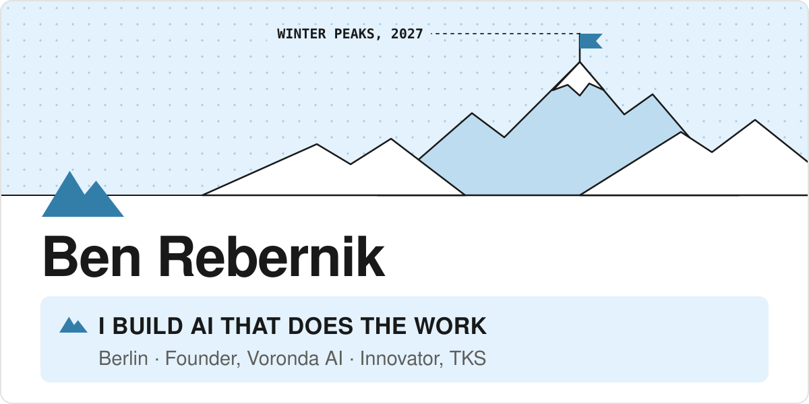
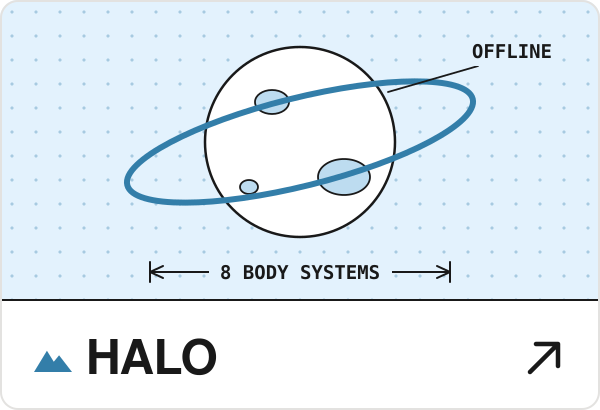
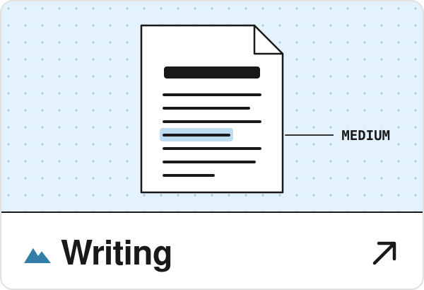

  
  
  
  

Hi, I'm Ben. I live in Berlin, run Voronda AI, and I'm an Innovator at TKS, where my focus is autonomous AI. I like software that does the job and then asks before it does anything it cannot take back.

<table>
<tr>
<td width="50%" valign="top">
  
  
A little cloud in your Mac's notch that gets to work before you ask, and waits for your OK before it sends a message. Open source.

  
<a href="https://github.com/nubidubi09/Bloub">Code</a> · <a href="https://nubidubi09.github.io/Bloub/">Website and video</a>

</td>
<td width="50%" valign="top">
  
  
My company. Custom AI software for schools, practices and offices that runs on a server only they use.

  
<a href="https://voronda.org">voronda.org</a>

</td>
</tr>
<tr>
<td width="50%" valign="top">
  
  
An offline AI crew medical officer for astronauts. NASA Space Apps Challenge 2026, a team of five. I did the design.

  
<a href="https://github.com/leonardoperugia09-cyber/nsac26">Team repository</a>

</td>
<td width="50%" valign="top">
  
  
Why chatbots aren't the AI of today anymore, what an always-on AI costs, and how to build one that asks first.

  
<a href="https://medium.com/@ben.rebernik/building-an-autonomous-ai-and-why-ai-chatbots-arent-the-ai-of-today-anymore-ad4c1ea91890">Read it</a>

</td>
</tr>
</table>

<h3>Now</h3>
<ul>
  <li>Building Bloub, and writing down what breaks</li>
  <li>Running Voronda AI</li>
</ul>

<h3>Off the screen</h3>

Mountains. In 2027 I want to get to winter peaks and learn ice climbing.

