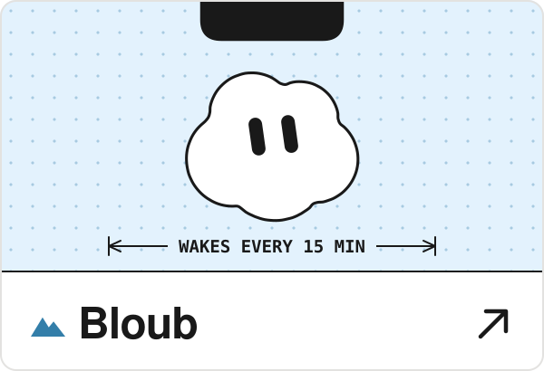
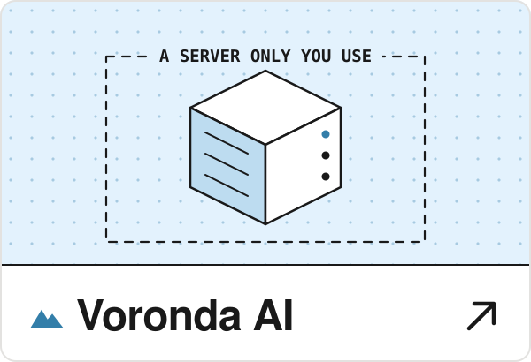

  
  
  
  
  

<h3>Hi, I'm Ben 👋</h3>

📍 <b>Berlin</b> &nbsp;|&nbsp; 🏔️ <b>Founder, <a href="https://voronda.org">Voronda AI</a></b> &nbsp;|&nbsp; 🚀 <b>Innovator at <a href="https://www.tks.world">TKS</a></b>

I made <b><a href="https://github.com/nubidubi09/Bloub">Bloub</a></b>, a Mac assistant that starts work before you ask, and waits for your OK before it sends a message.

  
  
  
  
  
  
  
  
  
  
  
  
  
  
  

What my projects are built with. AI coding tools write the code; I decide, design and test.

<h2>Start here</h2>

  
  
  

<ul>
  <li>☁️ <b><a href="https://github.com/nubidubi09/Bloub">Bloub</a></b>: the open-source assistant in the notch. <a href="https://nubidubi09.github.io/Bloub/">Video</a> · <a href="https://github.com/nubidubi09/Bloub">Code</a> · <a href="https://github.com/nubidubi09/homebrew-bloub">Homebrew tap</a></li>
  <li>🖥️ <b><a href="https://voronda.org">Voronda AI</a></b>: custom AI software on a server only you use. <a href="https://voronda.org/contact">Free demo</a></li>
  <li>🪐 <b><a href="https://github.com/leonardoperugia09-cyber/nsac26">HALO</a></b>: an offline AI crew medical officer for astronauts, NASA Space Apps 2026. Team of five; I did the design.</li>
</ul>

Install Bloub (macOS 27.2, Xcode and your own Claude API key):

<pre><code>brew install --HEAD nubidubi09/bloub/bloub</code></pre>

<h2>Writing</h2>
<ul>
  <li>✍️ <a href="https://medium.com/@ben.rebernik/building-an-autonomous-ai-and-why-ai-chatbots-arent-the-ai-of-today-anymore-ad4c1ea91890">Building an Autonomous AI and why AI chatbots aren’t the AI of Today anymore</a> (26 Oct 2026)</li>
</ul>

<h2>Fun facts</h2>
<ul>
  <li>My first TKS build could black out the screen while I typed.</li>
  <li>On its first day working alone, Bloub wrote to me in German.</li>
  <li>Its first real job cost 26 cents.</li>
  <li>Off the screen: mountains. In 2027 I want winter peaks and ice climbing.</li>
</ul>
